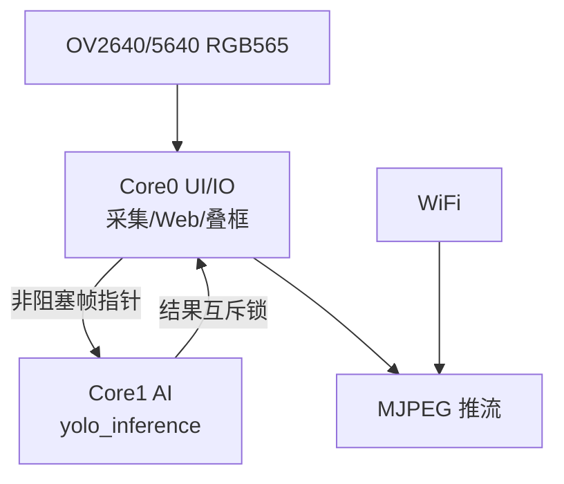
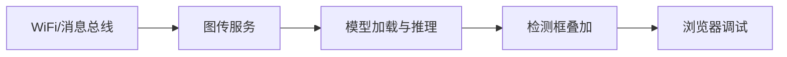

# Esp32s3_Vision_Assist

「随身智护」ESP32-S3-N8R16 终端：摄像头 RGB565 双缓冲、Web MJPEG、Core1 AI 推理（人脸/目标检测），面向视障辅助场景。

## 系统架构图

## 功能框图

## 远程

origin → https://github.com/linxi27667/Esp32s3_Vision_Assist.git
